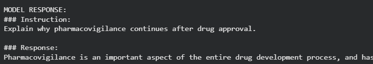

#  Multi-Stage Fine-Tuning of TinyLlama for Pharmaceutical Domain 

> An end-to-end Large Language Model (LLM) adaptation pipeline that transforms a general-purpose TinyLlama model into a pharmaceutical domain expert using **Domain Adaptive Pretraining (DAPT)**, **Instruction Fine-Tuning (SFT)**, and **Direct Preference Optimization (DPO)** with parameter-efficient fine-tuning techniques.

---

## 📖 Project Overview

This project demonstrates a complete production-style workflow for adapting an open-source Large Language Model to a specialized pharmaceutical domain.

Instead of relying on a single fine-tuning stage, the model is trained through **three sequential adaptation phases**, enabling it to acquire domain knowledge, follow user instructions, and generate more preference-aligned responses.

The project follows modern LLM adaptation techniques used in industry while remaining computationally efficient through **QLoRA**, **LoRA**, and **4-bit quantization**.

---

## 🚀 Key Features

- End-to-end LLM adaptation pipeline
- Pharmaceutical document preprocessing
- PDF text extraction and cleaning
- Domain Adaptive Pretraining (DAPT)
- Supervised Instruction Fine-Tuning (SFT)
- Direct Preference Optimization (DPO)
- Parameter Efficient Fine-Tuning (PEFT)
- QLoRA with 4-bit NF4 quantization
- LoRA adapter merging
- Custom inference pipeline
- Modular and reproducible workflow

---

# 🏗️ Pipeline Architecture

```
                    Pharmaceutical PDF
                            │
                            ▼
                PDF Text Extraction (PyMuPDF)
                            │
                            ▼
                 Cleaning & Normalization
                            │
                            ▼
                 Paragraph Dataset Creation
                            │
                            ▼
        ┌─────────────────────────────────────┐
        │ Stage 1 : Domain Adaptive Training  │
        │        (Continued Pretraining)      │
        └─────────────────────────────────────┘
                            │
                            ▼
                 Merge LoRA into Base Model
                            │
                            ▼
        ┌─────────────────────────────────────┐
        │ Stage 2 : Instruction Fine-Tuning   │
        │        (Supervised Learning)        │
        └─────────────────────────────────────┘
                            │
                            ▼
                 Merge Instruction Adapter
                            │
                            ▼
        ┌─────────────────────────────────────┐
        │ Stage 3 : Preference Optimization   │
        │              (DPO)                  │
        └─────────────────────────────────────┘
                            │
                            ▼
           Final Pharmaceutical Language Model
```


---

# ⚙️ Technologies Used

| Category | Technology |
|-----------|------------|
| Programming | Python |
| Deep Learning | PyTorch |
| LLM Library | Hugging Face Transformers |
| Fine-Tuning | PEFT |
| Quantization | BitsAndBytes |
| LoRA | QLoRA |
| Preference Optimization | TRL (DPOTrainer) |
| Dataset | Hugging Face Datasets |
| PDF Processing | PyMuPDF |
| Tokenization | AutoTokenizer |

---


# 📚 Training Stages

## Stage 1 — Domain Adaptive Pretraining (DAPT)

The model first learns pharmaceutical terminology and writing style from domain-specific documents.

Objectives:

- Learn medical vocabulary
- Adapt language distribution
- Improve pharmaceutical understanding
- Continue causal language modeling

---

## Stage 2 — Instruction Fine-Tuning (SFT)

The adapted model is then fine-tuned using instruction-response pairs.

Example:

```
Instruction:
Explain the mechanism of action of Metformin.

Response:
Metformin primarily reduces hepatic glucose production...
```

This stage improves:

- Instruction following
- Question answering
- Response formatting
- Knowledge retrieval

---

## Stage 3 — Direct Preference Optimization (DPO)

Finally, the model is preference tuned using chosen vs rejected responses.

Benefits:

- Better response quality
- Reduced hallucinations
- More helpful answers
- Improved alignment

---
### Sample Inference

The following example shows the response generated by the preference-tuned model.


